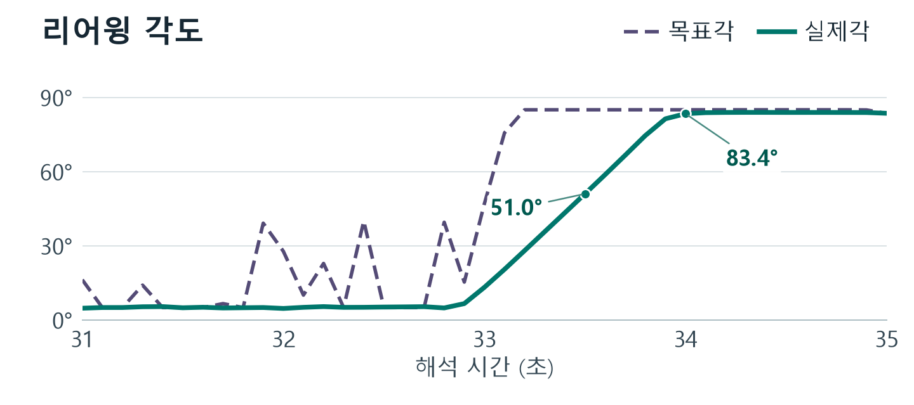

# 2026 RecurDyn Simulation 경진대회 출품작

**RC카 액티브 리어윙 설계와 동역학 해석** · 강태욱 / 충남대학교 AeroMotionReWing 팀

직선에서는 윙을 눕혀 공기저항을 줄이고, 코너에서는 윙을 세워 뒷바퀴를 지면 쪽으로 누르는 힘을 키우려 했습니다. 저는 **차량 CAD 모델링, 실물 RC카 제작, RecurDyn 조인트·구속 설정**을 맡았습니다.

초기 해석에서는 윙이 한 바퀴 넘게 돌았습니다. 팀은 힌지의 강제 회전을 풀고, 공기력은 차체에, 서보 토크는 윙에 걸었습니다. 수정 후 66초 주행 해석에서 윙은 **4.56°~88.92°** 사이를 움직였습니다.

점선은 목표각, 실선은 해석에서 윙이 움직인 각도입니다. 목표각이 85°일 때 실제각은 33.5초에 51.0°, 34.0초에 83.4°였습니다.

[최종 발표 PDF](presentation/Final_Report.pdf) · [힌지·서보 구성 코드](analysis/stage43_repair_active_wing.py) · [솔버 모델](model/TypeB_TEST.rmd) · [66초 결과와 원본 Plot](results/README.md)

## 윙을 눕히면 항력이 얼마나 줄었나

고속 직선에서 **40° 고정윙의 항력은 약 1.0 N**, **5° 액티브윙은 약 0.25 N**이었습니다. 약 75%라는 차이는 발표 그래프의 직선 구간 ②에서 읽은 값입니다. [항력 비교 그래프](assets/drag_comparison.png) · [발표 PDF 29쪽](presentation/Final_Report.pdf)

## 차량 설계와 실물 시험

| 초기 차량 조립체 | 주행 중 리어윙 전환 |
| --- | --- |
|  |  |

마이크로프로세서실험에서 만든 RC카로 정지 상태와 주행 중에 윙이 움직이는 모습을 촬영했습니다. 실물 시험에서는 윙의 동작을 확인했고, 윙각과 항력 수치는 RecurDyn 해석에서 얻었습니다. [차량 STEP](cad/Stage15_assembly.step) · [무선 조종기와 실물 시험 영상](prototype/README.md)

## 자료와 실행 방법

| 보고 싶은 내용 | 자료 |
| --- | --- |
| 제작과 조립 | [차량 CAD와 도면](cad/README.md) · [조종기와 서보 제어](prototype/README.md) |
| 해석과 재현 | [솔버 입력과 실행 조건](model/README.md) · [모델 구성 코드와 Python 검증 명령](analysis/README.md) |
| 결과와 발표 | [윙각·토크·솔버 로그](results/README.md) · [최종 발표 목차](presentation/README.md) |
