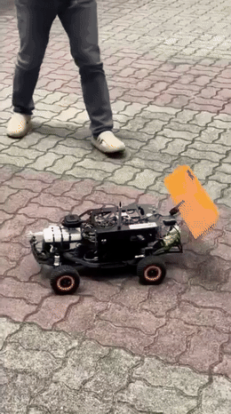
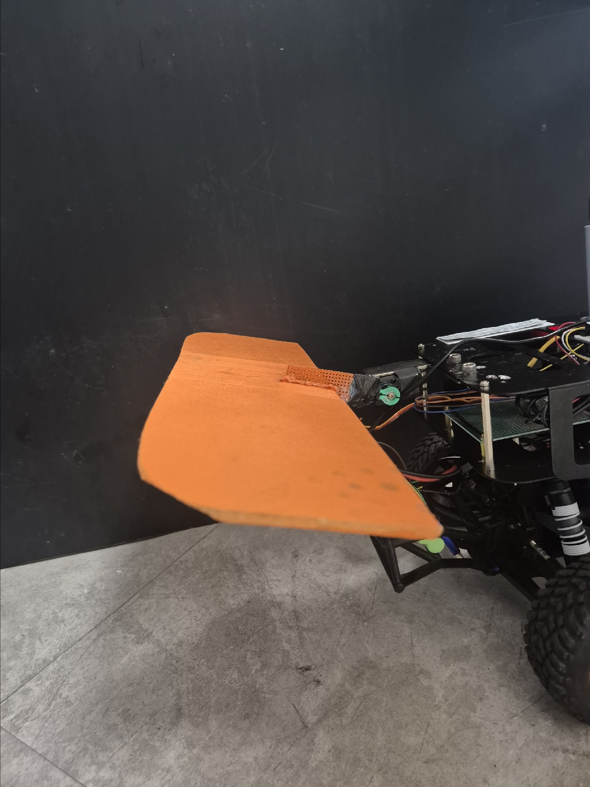
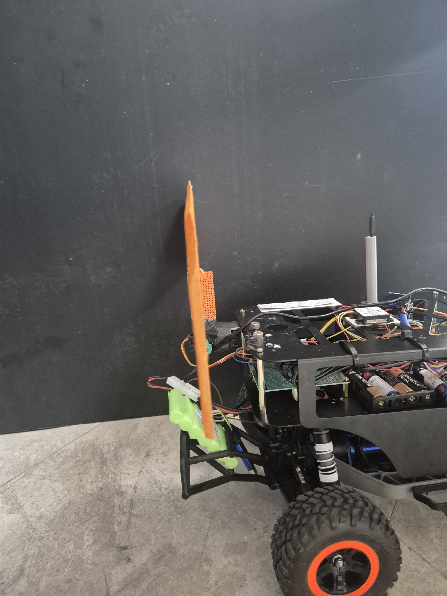

# AeroMotionReWing · 주행 상태에 따라 움직이는 RC카 리어윙

직선에서는 항력을 줄이고 코너에서는 다운포스를 확보하기 위해 윙 각도를 바꾸는 RC카를 만들었습니다. **저는 차량 CAD 모델링, 실물 RC카 제작, RecurDyn 조인트·구속 설정을 담당했습니다.**  
강태욱 · 충남대학교 · 2026 RecurDyn Simulation 경진대회 팀 프로젝트

주황색 윙의 각도를 보세요. 실물에서는 주행 중 윙이 전환되는 모습을 확인했습니다. **팀의 고속 직선 해석**에서는 40° 고정윙과 5° 액티브윙의 항력 크기가 각각 **약 1.0 N과 0.25 N**이었습니다.

**[최종 발표 · 41쪽](presentation/Final_Report.pdf)** · [차량 STEP](cad/Stage15_assembly.step) · [최종 솔버 입력](model/TypeB_TEST.rmd) · [모델 구성 코드](analysis/stage43_repair_active_wing.py) · [66초 검증 수치](results/stage43_r2_full_validation.json)

## 기구를 만들고 윙의 회전을 바로잡은 과정

| 실물 저각 | 실물 고각 | 차량 조립체의 등각도 |
| --- | --- | --- |
|  |  |  |

실물에서는 조이스틱 명령이 LoRa를 거쳐 차량의 STM32로 전달되고 PWM 서보가 윙을 움직입니다. 정지 상태와 주행 중에 윙 전환을 육안으로 확인했습니다. 실물 윙각과 공력하중은 계측하지 않았습니다. [정지 시험과 주행 시험](prototype/README.md)

초기 해석 모델에서는 윙과 차체 사이의 내부력이 힌지에 큰 모멘트를 만들고, 힌지에 강제 회전까지 걸려 윙이 한 바퀴 이상 돌았습니다. 팀은 공력을 차체의 공력중심에 적용하고, 윙은 회전 힌지와 ±3 N·m 제한토크 서보로 움직이도록 변경했습니다. 66초 해석에서 윙은 **4.556–88.922°** 사이를 움직였고 최대 토크는 **2.985 N·m**였습니다. 목표 하한 5°를 최대 0.444° 밑돈 구간도 있었습니다. [구성 코드](analysis/stage43_repair_active_wing.py) · [윙각·토크 그래프](assets/wing_response.png) · [솔버 로그](results/TypeB_TEST.log)

## 고정윙과 비교한 결과

약 29–33초의 고속 직선 구간에서 두 곡선을 비교하면, 윙을 5°로 낮춘 경우 항력 크기가 약 75% 작았습니다. 이 값은 최종 발표 29쪽 그래프에서 읽은 특정 구간의 근삿값입니다. 코너 비교에서는 기준이 바뀌며, 5° 고정윙과 40° 액티브윙의 후륜 하중·요레이트 응답은 32–35쪽에서 볼 수 있습니다. [전체 발표](presentation/Final_Report.pdf) · [차량 주행 애니메이션](results/driving.mp4)

## 자료와 실행

| 자료 | 바로 확인할 내용 |
| --- | --- |
| [발표](presentation/README.md) | 개발 배경, 실물, 모델, 공력·제어, 결과와 참고문헌 |
| [실물 제작](prototype/README.md) | 저각·고각 사진과 두 가지 동작 영상 |
| [CAD](cad/README.md) | 초기 차량 조립 STEP, 정면·측면·평면도, 조립 그룹별 부품 수 |
| [최종 해석 모델](model/README.md) | RecurDyn 솔버 입력, 실제 타이어 설정과 주행 경로 |
| [모델링·검증 코드](analysis/README.md) | 힌지·서보·공력 구성, 브레이크 연동, Plot 채널 검사와 힘 대조 |
| [해석 결과](results/README.md) | 검증 기록과 해시가 일치하는 Plot, 로그, JSON, 주행 영상 |
