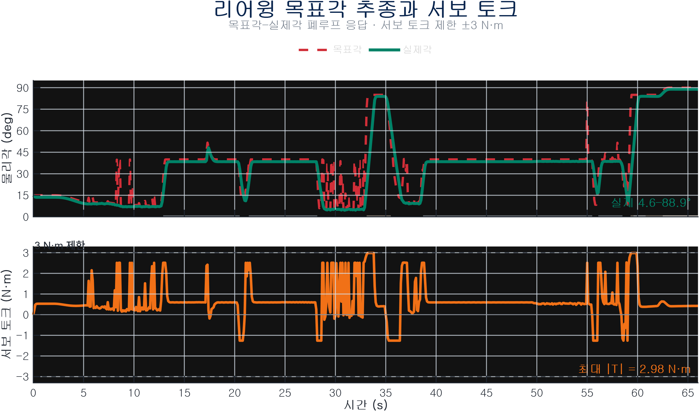
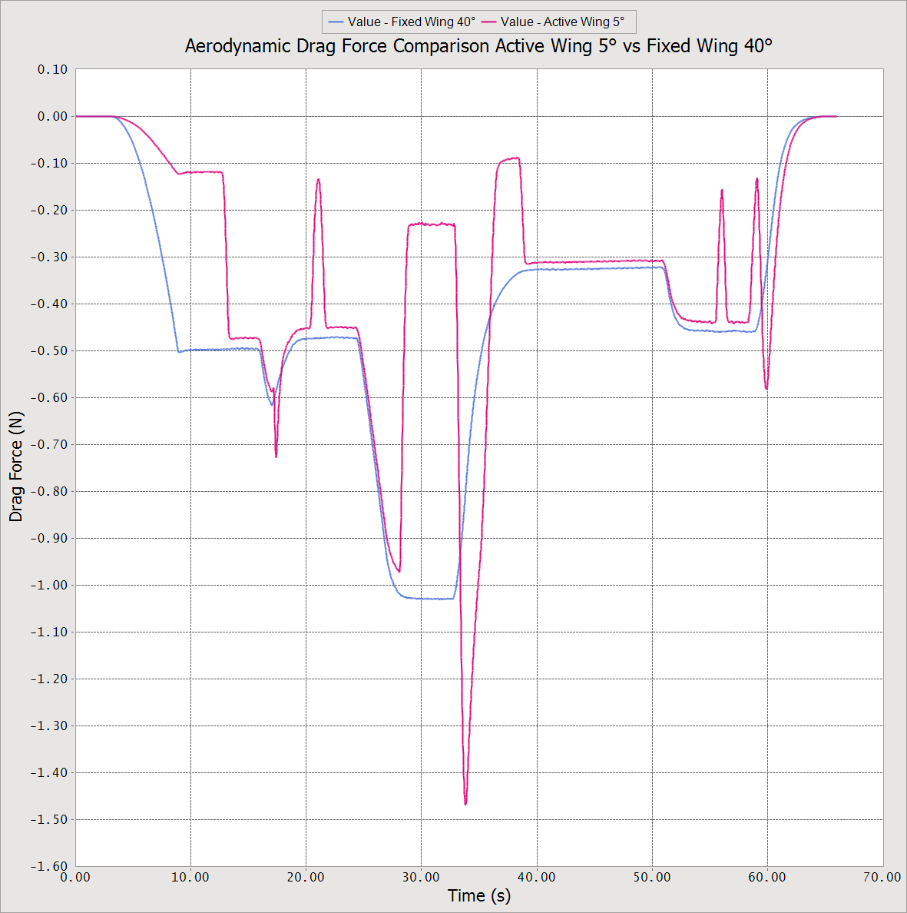
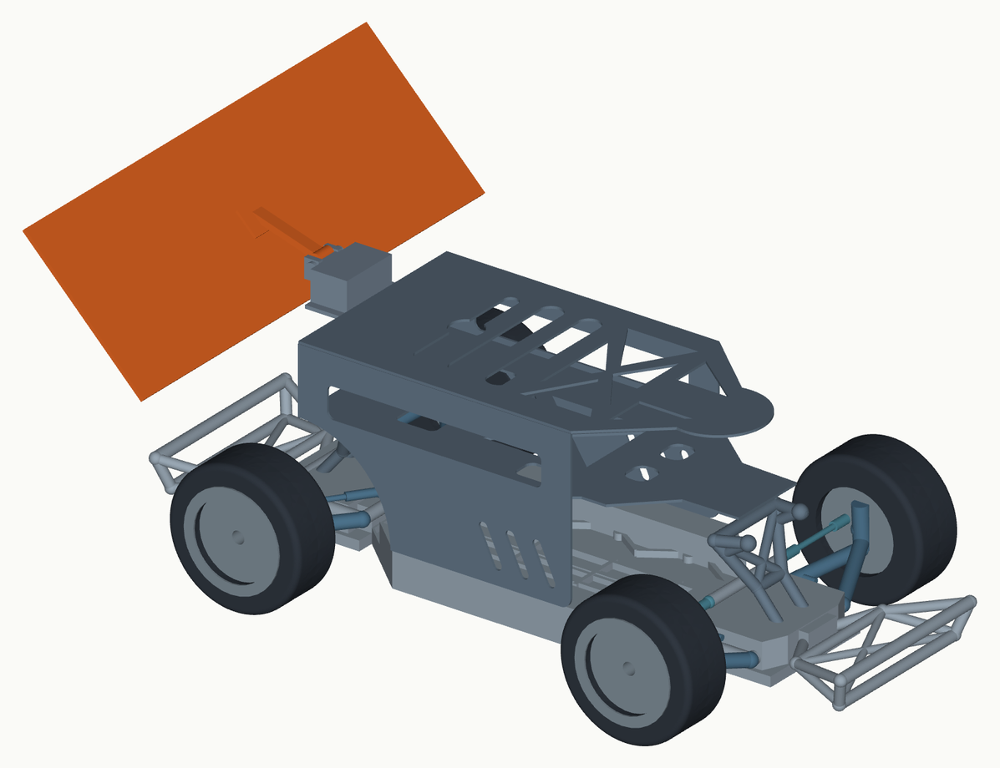

# 2026 RecurDyn Simulation 경진대회 출품작

## 주행 상태에 따라 각도를 바꾸는 RC카 리어윙

직선에서는 윙을 눕혀 항력을 줄이고, 코너에서는 윙을 세워 다운포스를 확보하려 했습니다. 충남대학교 AeroMotionReWing 팀으로 참가했고, **저는 차량 CAD 모델링, 실물 RC카 제작, RecurDyn 조인트·구속 설정을 맡았습니다.**

초기 모델은 윙이 힌지에서 한 바퀴 이상 돌았습니다. 팀은 공력을 차체에 적용하고 윙에는 **±3 N·m로 제한한 서보 토크**를 걸었습니다. 66초 주행 해석에서 윙은 **4.56°에서 88.92°** 사이를 움직였고, 최대 토크는 **2.985 N·m**였습니다.

위 그래프에서는 목표각이 급변할 때 실제 윙이 얼마나 늦게 따라가는지, 아래 그래프에서는 그때 서보에 걸린 토크를 볼 수 있습니다. 목표 하한 5°를 최대 0.444° 밑돈 구간이 있었습니다.

[대회 최종 발표 · 41쪽](presentation/Final_Report.pdf) · [힌지·서보 구성 코드](analysis/stage43_repair_active_wing.py) · [최종 해석 모델](model/TypeB_TEST.rmd) · [수치 기록](results/stage43_r2_full_validation.json) · [솔버 로그](results/TypeB_TEST.log)

## 고정윙과 비교한 결과

약 29–33초의 고속 직선 구간에서 40° 고정윙의 항력 크기는 약 1.0 N, 5°로 낮춘 액티브윙은 약 0.25 N이었습니다(약 75% 감소). 이 값은 최종 발표 29쪽 그래프에서 읽은 특정 구간의 근삿값입니다. 코너 비교에서는 기준이 바뀌며, 5° 고정윙과 40° 액티브윙의 후륜 하중·요레이트 응답은 32–35쪽에서 볼 수 있습니다. [전체 발표](presentation/Final_Report.pdf) · [차량 주행 애니메이션](results/driving.mp4)

## 차량 설계와 실물 시험

| 초기 차량 조립체 | 정지 상태의 윙 저각 · 고각 |
| --- | --- |
|  |  [고각 사진](prototype/wing-high.jpg) |

마이크로프로세서실험에서 제작한 RC카는 경진대회에서 윙 구동을 확인하는 데 사용했습니다. 조종기의 무선 명령이 차량의 STM32에 전달되면 서보가 윙을 움직입니다. 아래 영상에서 주행 중 주황색 윙이 전환되는 모습을 볼 수 있습니다. 실물에서는 윙각과 공력하중을 계측하지 않았습니다.

[차량 STEP](cad/Stage15_assembly.step) · [무선 조종기와 정지·주행 시험](prototype/README.md)

## 자료와 실행

| 자료 | 바로 확인할 내용 |
| --- | --- |
| [발표](presentation/README.md) | 개발 배경, 실물, 모델, 공력·제어, 결과와 참고문헌 |
| [실물 제작](prototype/README.md) | 저각·고각 사진과 두 가지 동작 영상 |
| [CAD](cad/README.md) | 초기 차량 조립 STEP, 정면·측면·평면도, 조립 그룹별 부품 수 |
| [최종 해석 모델](model/README.md) | RecurDyn 솔버 입력, 실제 타이어 설정과 주행 경로 |
| [모델링·검증 코드](analysis/README.md) | 힌지·서보·공력 구성, 브레이크 연동, Plot 채널 검사와 힘 대조 |
| [해석 결과](results/README.md) | 검증 기록과 해시가 일치하는 Plot, 로그, JSON, 주행 영상 |
