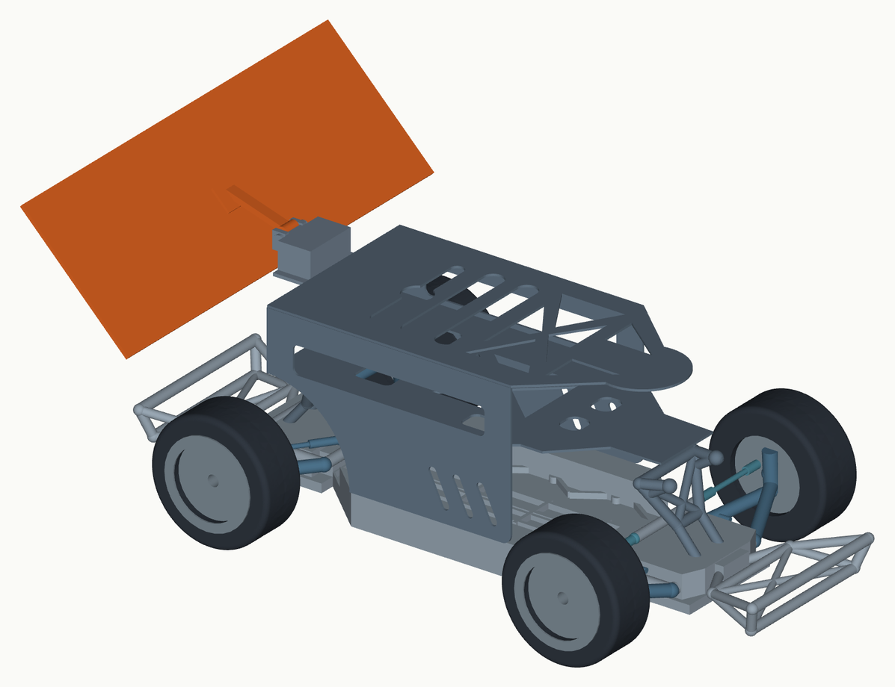

# 차량 조립체 CAD

[Stage 15 차량 조립 STEP](Stage15_assembly.step)은 현가·조향·차체 조립 관계를 검토하던 단계의 설계입니다. 당시 재개방 검증 기록의 솔리드 수는 209개입니다. STEP을 지원하는 CAD 뷰어에서 형상과 부품 배치를 확인할 수 있습니다.

네 바퀴가 닿는 면을 수평으로 놓고 앞쪽에서 본 조립체입니다. STEP의 +X는 차량 앞쪽, Y는 바퀴 축, +Z는 위쪽입니다. 주황색은 뒤쪽 리어윙입니다.

[정면도](front.png) · [측면도](side.png) · [평면도](top.png) · [조립 그룹별 수량·체적](assembly_groups.csv)

이 단계에서는 윙 각도를 구동했고, 가변 공력과 차량의 연동은 이후 [Stage 43 모델](../model/README.md)에서 구현했습니다.
