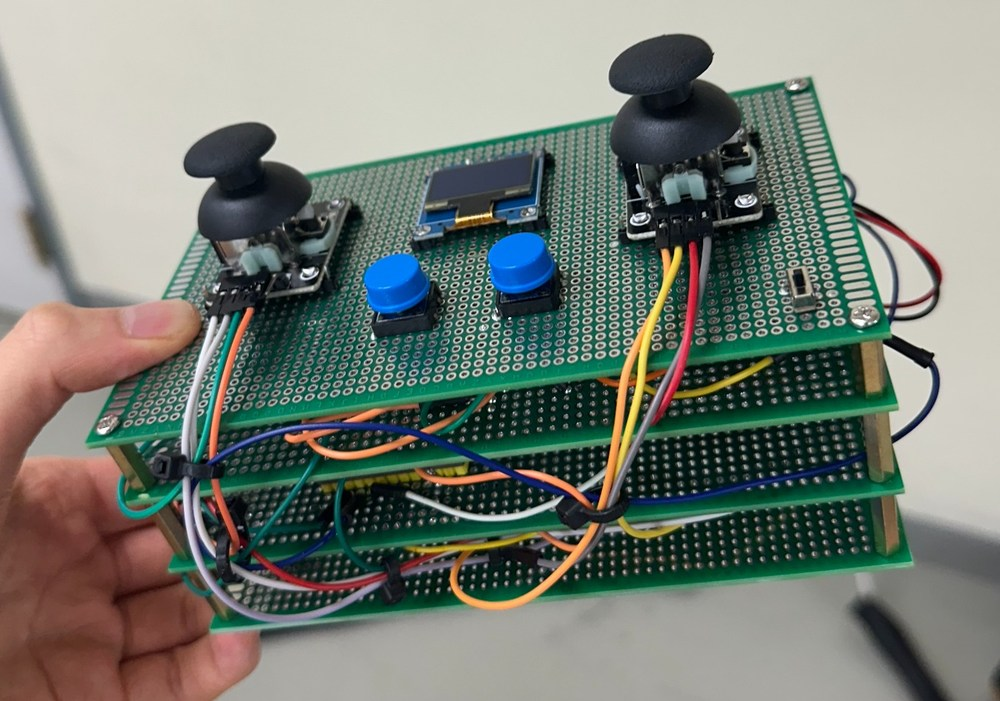

# 실물 RC카의 무선 조종과 리어윙 시험

마이크로프로세서실험에서 제작한 조종기입니다. 상단 기판에 조이스틱 두 개와 버튼, OLED를 배치하고 기판을 3단으로 쌓았습니다.



조이스틱과 버튼 입력을 9바이트 패킷에 담아 433 MHz LoRa로 보냅니다. 차량의 STM32는 구동 명령을 CAN으로 VESC에 보내고, 별도 PWM 출력으로 리어윙 서보를 움직입니다.

조종기 펌웨어는 45 ms 주기로 명령을 보내고, 송신 직후에는 24 ms 동안 차량의 상태 응답을 받습니다. 아래 두 값은 조종기 코드에 설정한 시간입니다.

```c
#define CONTROLLER_LORA_CMD_PERIOD_MS 45U
#define CONTROLLER_LORA_POST_TX_RX_WINDOW_MS 24U
```

대회 발표에 기록한 자동 전환 로직은 VESC 속도에서 종방향 가속도를 계산합니다. −1.5 m/s² 이하에서는 윙을 세우고, −0.5 m/s² 이상에서는 눕힙니다. 두 값 사이에서는 현재 위치를 유지하고, 속도 데이터가 오래되면 저각으로 복귀합니다. 실물 영상에서 확인한 범위는 윙의 전환 동작까지입니다. [대회 발표 13–15쪽](../presentation/Final_Report.pdf)

| 시험 | 관찰할 동작 |
| --- | --- |
| [정지 상태 영상](wing-bench.mp4) | 차량이 정지한 상태에서 서보가 윙을 회전시킵니다. |
| [주행 중 영상](wing-driving.mp4) | 차량이 움직이는 동안 주황색 윙이 저각과 고각 사이에서 전환됩니다. |
| [저각 사진](wing-low.jpg) · [고각 사진](wing-high.jpg) | 두 위치에서의 실제 기구 형상을 비교할 수 있습니다. |

두 영상은 최종 발표에 삽입된 실물 시험 영상입니다. 영상 플레이어로 재생하면 됩니다. 공력 비교 결과는 [시뮬레이션](../results/README.md)에 정리했습니다.
