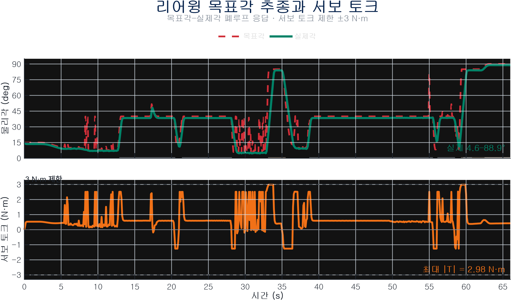

# 66초 해석 결과

최종 액티브윙 해석은 0.01초 간격으로 6,601개 프레임을 기록했습니다. 최대속도는 26.805 km/h, 윙각은 4.556–88.922°, 최대 서보 토크는 2.985 N·m였습니다. 토크 제한은 ±3 N·m였습니다. 윙은 목표 하한 5°를 최대 0.444° 밑돌았습니다.



| 자료 | 읽는 방법 |
| --- | --- |
| [윙각 시계열 CSV](wing_angles_0p1s.csv) | 원본 Plot의 0.01초 기록에서 10개마다 한 행을 뽑았습니다. 0~66초의 목표각과 실제각 661쌍(° 단위, 소수 셋째 자리)을 볼 수 있습니다. |
| [주행 영상](driving.mp4) | 직선·코너 구간에서 주행하는 모델과 윙을 확인합니다. |
| [66초 Plot ZIP](Plot_66s.zip) | Git LFS로 내려받고 압축을 푼 뒤 RecurDyn Plot에서 `TypeB_TEST.rplt`를 엽니다. |
| [채널별 수치·검증](stage43_r2_full_validation.json) · [솔버 로그](TypeB_TEST.log) | 실제각 범위, 토크 최댓값, 정상 종료를 확인합니다. |
| [솔버 힘 대조](stage43_r2_solver_applied_aero_validation.json) · [허용치 판정](stage43_r2_solver_aero_acceptance.json) | 항력·다운포스·피칭모멘트의 계산식과 솔버 출력 차이를 확인합니다. |
| [최종 검증 요약](FINAL_VALIDATION_SUMMARY.md) | 최종 모델의 회전 문제와 허용오차를 읽습니다. |

```bash
git lfs install
git clone https://github.com/ktw25079/AeroMotionReWing.git
cd AeroMotionReWing
git lfs pull --include="results/Plot_66s.zip"
```

Plot에서 `TRX43_REQ_ACTIVE_WING_PROOF`의 F2·F3은 목표각·실제각, `TRX43_REQ_ACTIVE_WING_HEALTH`의 F1은 서보 토크입니다. 압축 내부 Plot은 185,014,788바이트이며 SHA-256은 검증 JSON의 `rplt_sha256`과 일치합니다. 고정윙과의 항력 비교는 [최종 발표 29쪽](../presentation/Final_Report.pdf)의 그래프를 근거로 합니다.
